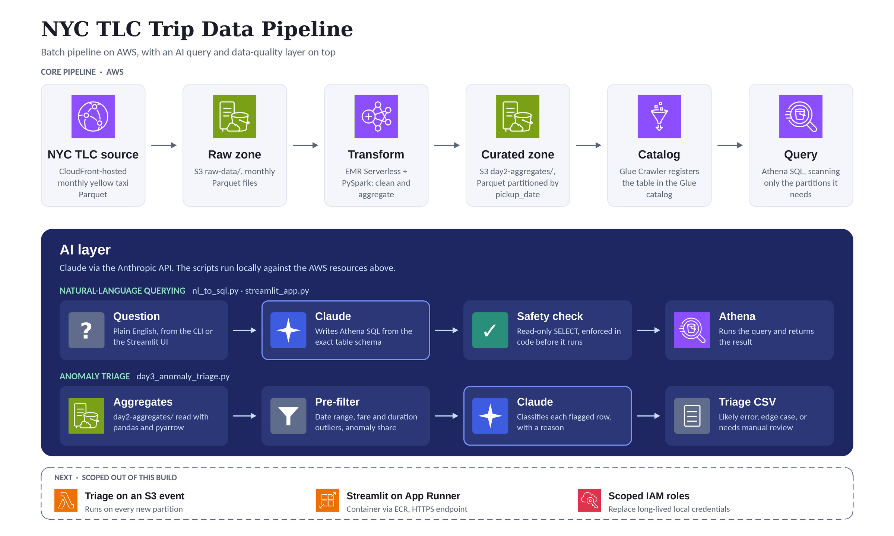

# NYC TLC Trip Data Pipeline: EMR Serverless + PySpark + Claude

A batch data pipeline built solo to process NYC Taxi & Limousine Commission (TLC) trip data with AWS EMR Serverless and PySpark. Results are cataloged in AWS Glue and queried through Amazon Athena. A Claude-powered AI layer on top adds natural-language querying and anomaly triage.



## Architecture

**Core pipeline**

```
NYC TLC (CloudFront) → S3 (raw) → EMR Serverless (PySpark) → S3 (partitioned Parquet)
                                                                      ↓
                                                              AWS Glue Crawler
                                                                      ↓
                                                              Amazon Athena (SQL)
```

- **Compute:** EMR Serverless, chosen over a persistent cluster because it bills per second and needs no cluster sizing. This is a batch job with no recurring schedule, so idle cost would be pure waste.
- **Storage:** Amazon S3, with output written as Parquet partitioned by `pickup_date`.
- **Catalog:** AWS Glue Crawler infers the schema and registers the output as a table.
- **Query:** Amazon Athena runs directly against the partitioned output.
- **Why not Airflow or Delta Lake:** there is no recurring schedule and no update/merge workload, so Glue + Athena is the simpler fit.

**AI layer** (runs locally against the AWS resources above)

- `nl_to_sql.py` and `streamlit_app.py`: ask a question in English, Claude writes Athena SQL, a code-level check enforces a read-only SELECT, then Athena runs it.
- `day3_anomaly_triage.py`: a statistical pre-filter flags suspicious aggregate rows, and Claude classifies only that small subset.

## What the pipeline does

1. **Ingest:** pulls monthly NYC yellow taxi trip records (Parquet) from TLC's public distribution.
2. **Schema handling:** merges schema across files and standardizes column names, since TLC's schema has drifted across years (for example, a `cbd_congestion_fee` column added in Jan 2025).
3. **Cleaning:** filters malformed records, such as non-positive or absurd trip durations and negative distance or fare values.
4. **Feature engineering:** computes trip duration, average speed, and a basic speed-based anomaly flag.
5. **Aggregation:** groups by pickup date, hour, and pickup zone.
6. **Output:** writes partitioned Parquet so downstream queries scan only the relevant date partitions.

## Results

Run against 3 months of data (Jan–Mar 2024):

| Metric | Value |
|---|---|
| Raw records read | 9,554,778 |
| Clean records after filtering | 9,410,003 |
| Dropped as malformed | 144,775 (~1.5%) |
| Output partitions | 97 (by `pickup_date`) |
| Sample Athena query runtime | 1.378 sec, 5.76 MB scanned |

The small scan volume on the sample query confirms the date-partitioning strategy works as intended.

## AI layer

### Natural-language querying

Querying the table normally requires knowing SQL and the exact schema. Here you ask a plain-English question and Claude generates the Athena SQL from the table's real schema. The query is checked in code before it touches Athena, and questions the schema cannot answer return `NOT_ANSWERABLE`.

| Question | Outcome |
|---|---|
| Total trip count for `pickup_hour` 8 | 367,298 |
| Average fare amount on 2024-01-15 | about $25.23 |
| "Delete all records where `anomalous_trip_count` > 0" | Refused. No query executed. |

The refusal is not left to the model. `is_safe_select` independently verifies that the statement is a single read-only SELECT before anything runs.

### Anomaly triage

This closes the known limitation below. `day2_aggregates` holds pre-aggregated rows (per date, hour, and pickup zone), so triage works on aggregate rows rather than individual trips.

1. A cheap statistical pre-filter flags rows with out-of-range dates, fare or duration outliers (outside p01/p99), or a high share of already-anomalous trips.
2. Only that subset goes to Claude, which classifies each row as `likely_data_entry_error`, `legitimate_edge_case`, or `needs_manual_review`, with a one-sentence reason.

On a random sample of 50 flagged rows (out of 240,649 flagged), the split was 23 legitimate edge cases, 22 likely data-entry errors, and 5 needing manual review. Run directly on the two known-bad partitions, `2002-12-31` (2 rows) and `2008-12-31` (1 row) were all classified `likely_data_entry_error`.

Triage is a **detection** layer. It surfaces and explains bad rows but does not prevent them from being written. Date-range validation inside `day2_transform.py` would be the preventive fix.

## Real issues hit & resolved

1. **Broken documented data source:** the commonly referenced `s3://nyc-tlc` bucket returns `AccessDenied` (inaccessible since about 2022). Sourced from TLC's current CloudFront distribution instead.
2. **Spark ANSI-mode cast failure:** a direct `TIMESTAMP → BIGINT` cast fails under Spark's ANSI mode, the default from Spark 4.x. Fixed with `unix_timestamp()`.
3. **Athena `TYPE_MISMATCH` (varchar = date):** Glue inferred `pickup_date` as a string, so `DATE '2024-01-15'` comparisons failed. Fixed by describing the column as a `'YYYY-MM-DD'` string in the model's schema prompt.
4. **Categorical dtype:** pandas/pyarrow read Hive partition columns as `Categorical`, which cannot be compared with `<` / `>`. Fixed by casting to string before parsing dates.
5. **`row_id` merge error:** the model's JSON returned numeric IDs as ints while the dataframe used strings. Fixed by casting both sides to string before merging.
6. **Partition column lost:** reading a single `pickup_date=...` folder drops the partition column, because pyarrow only reconstructs it from a dataset root. Fixed by recovering the date from the `--input` path.
7. **Missing IAM permission:** `glue:GetPartitions` was needed for Athena to resolve partitions. Added to the policy.

## Known limitation

A handful of output partitions contain clearly invalid pickup dates (for example years 2002 and 2008). They pass duration and fare validation because those checks validate the trip, not the calendar date. The anomaly triage step now detects and explains them. Rejecting them at write time is still the next improvement.

## Productionizing

The AI scripts run locally by design, to keep this build scoped. The path to running them in AWS:

- **Triage on AWS Lambda:** triggered by an S3 event on each new partition, with the Anthropic API key in AWS Secrets Manager.
- **Streamlit on AWS App Runner:** containerized and pushed to ECR, served at an HTTPS endpoint.
- **Scoped IAM roles:** replace long-lived local credentials. Least privilege is `athena:StartQueryExecution`, `GetQueryExecution`, `StopQueryExecution`, `GetQueryResults`; `glue:GetTable`, `GetDatabase`, `GetPartitions`; and S3 get/put/list on the output bucket only.

## Files

- `day1_smoke_test.py`: minimal read/count/write job to validate the EMR Serverless + S3 plumbing.
- `day2_transform.py`: the full transformation (schema handling, cleaning, feature engineering, aggregation, partitioned write).
- `nl_to_sql.py`: natural-language to Athena SQL, with the read-only safety check.
- `streamlit_app.py`: Streamlit UI over `nl_to_sql.py`.
- `day3_anomaly_triage.py`: statistical pre-filter plus Claude classification of flagged rows.
- `docs/architecture.png`: the architecture diagram above.

## Running it

**EMR scripts** (`day1_smoke_test.py`, `day2_transform.py`) run on EMR Serverless as Spark jobs.

**AI scripts** run locally:

```bash
pip3 install anthropic boto3 pandas pyarrow streamlit
export ANTHROPIC_API_KEY="your-key"      # never commit this
# AWS credentials configured (aws configure)

# Natural-language querying
python3 -m streamlit run streamlit_app.py

# Anomaly triage (point --input at the day2-aggregates root, or a pickup_date=... folder)
python3 day3_anomaly_triage.py \
  --input s3://<your-bucket>/<output-prefix>/day2-aggregates/ \
  --output triage_results.csv \
  --sample-size 50
```

## Tech stack

AWS EMR Serverless · PySpark · Amazon S3 · AWS Glue · Amazon Athena · Anthropic Claude API · Streamlit · pandas / pyarrow
